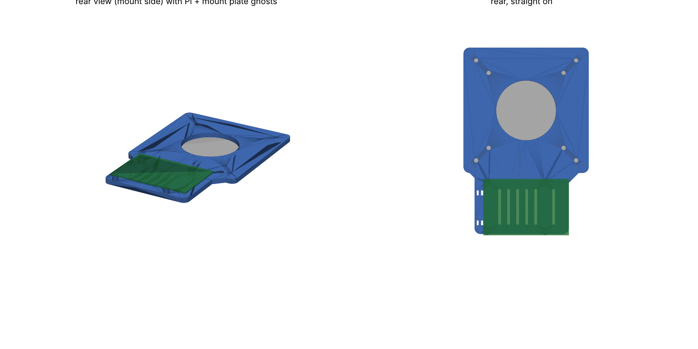

# Family Calendar Display

A DIY Skylight-style family calendar: a wall-mounted touchscreen that shows the
[Beacon](https://github.com/asachs01/beacon) family dashboard from Home Assistant. It
wakes when someone walks up and sleeps when nobody is around.



## How it fits together

```
Google Calendar ──> Home Assistant (Google Calendar integration) ──> Beacon add-on
                                                                        │ URL
Raspberry Pi 4 ── TouchKio (kiosk browser) ─────────────────────────────┘
      │  HDMI + USB (touch)
FYHXele 27" touchscreen  <── wlopm on/off ── presence-display.py <── GPIO17 <── LD2410C OUT
                                                     │
                                                     └─(optional) MQTT ─> Home Assistant
```

## Bill of materials

Links go to the specific Amazon listing where one is given, or to an Amazon search for
generic parts where any brand works. Prices change constantly, so check them when you
order. None of these are affiliate links.

| Qty | Part | Link | Notes |
|---|---|---|---|
| 1 | Raspberry Pi 4 Model B (2 GB+) | [search](https://www.amazon.com/s?k=Raspberry+Pi+4+Model+B+4GB) | 4 GB is comfortable for Chromium |
| 1 | Official Raspberry Pi 4 PSU, 5.1 V / 3 A USB-C | [listing](https://www.amazon.com/Raspberry-Official-Power-Supply-15-3W/dp/B07YD2LZDC) | Use its own supply; don't power it from the monitor's USB |
| 1 | microSD card, 32 GB+, A2 | [search](https://www.amazon.com/s?k=microSD+32GB+A2+U3) | Or boot from a USB SSD for a snappier kiosk |
| 1 | FYHXele 27" touchscreen, 1080p | [listing](https://www.amazon.com/FYHXele-Touchscreen-Multi-Touch-Computer-Warehouse/dp/B0F8MPKSVT) | 100 × 100 VESA. Connect HDMI **and** the USB touch cable |
| 1 | micro-HDMI → HDMI cable, 1 m | [search](https://www.amazon.com/s?k=micro+HDMI+to+HDMI+cable+1m) | Use the Pi's HDMI0 port (next to USB-C) |
| 1 | HLK-LD2410C mmWave sensor | [listing](https://www.amazon.com/Coliao-LD2410C-Presence-Millimeter-HLK-LD2410/dp/B0CLRNCBF7) | 2-pack with Dupont wires. Any genuine LD2410C works ([more listings](https://www.amazon.com/s?k=ld2410c)) |
| 3 | Female-female jumper wires, 30 cm | [search](https://www.amazon.com/s?k=dupont+jumper+wires+female+to+female+30cm) | Pi GPIO ↔ sensor. Get longer ones if the pod is off-center |
| 4 | M2 or M2.5 screws, 8–10 mm | [M2.5 kit](https://www.amazon.com/s?k=M2.5+screw+assortment+kit) · [M2 kit](https://www.amazon.com/s?k=M2+screw+assortment+kit) | Pick the matching bracket variant below |
| 4 | M2 / M2.5 heat-set inserts (optional) | [search](https://www.amazon.com/s?k=M2.5+heat+set+inserts+3d+printing) | Only for the `_heatset` bracket variants. Check the insert's hole size against `INSERT_D` |
| 4 | M4 VESA screws, ~5 mm longer than stock | [search](https://www.amazon.com/s?k=M4+VESA+monitor+mounting+screws+kit) | The bracket adds 5 mm between monitor and mount |
| 1 | 3M VHB double-sided tape | [search](https://www.amazon.com/s?k=3M+VHB+tape) | Sticks the sensor pod under the bottom bezel |
| 1 | VESA 100 wall mount or arm | [search](https://www.amazon.com/s?k=VESA+100x100+wall+mount+27+inch) | Mount plate ≤ 125 mm, or raise `PLATE` in the CAD script |
| — | PETG or ASA filament | — | About 90 cm³ for the bracket plus 5 cm³ for the pod |

## Hardware (`hardware/`)

A 5 mm plate sits between the monitor and the mount. The Pi hangs on a wing below it,
outside the mount's footprint, with the USB-C and micro-HDMI edge facing down. The
LD2410C goes in a separate pod under the bottom bezel, because the radar can't see
through the monitor.

| File (`hardware/stl/`) | Use |
|---|---|
| `pi4_vesa_bracket_M2.5_heatset.stl` | M2.5 heat-set inserts (3.6 mm holes, 5 mm deep) |
| `pi4_vesa_bracket_M2.5_selftap.stl` | M2.5 screws straight into plastic (2.2 mm pilot) |
| `pi4_vesa_bracket_M2_heatset.stl` | M2 heat-set inserts (3.2 mm holes, 4 mm deep) |
| `pi4_vesa_bracket_M2_selftap.stl` | M2 screws straight into plastic (1.75 mm pilot) |
| `ld2410c_pod.stl` + `ld2410c_pod_cap.stl` | Sensor enclosure, press-fit cap with cable notch |

STEP files are in `hardware/step/`. The source is `hardware/cad/pi_vesa_bracket.py`
(CadQuery). Edit the parameters at the top and run `python3 pi_vesa_bracket.py` to
regenerate every variant.

**Printing:** PETG or ASA (ASA near a sunny window). Use 4+ walls and 40 %+ infill on
the bracket. It prints flat with no supports. Print the pod face-down. Don't paint
the pod's 1.2 mm front wall, because the radar looks through it.

**Check before printing:**
- VESA pattern (100 mm and 75 mm holes are both included).
- Whether the VESA area is recessed. If it is, set `FRONT_SPACER`.
- Mount plate size versus `PLATE` (125 mm).

## Wiring

| LD2410C | Raspberry Pi 4 |
|---|---|
| VCC | 5 V (physical pin 2) |
| GND | GND (physical pin 6) |
| OUT | GPIO17 (physical pin 11) |
| TX / RX | not connected (configure over Bluetooth instead) |

OUT is a 3.3 V signal, so it's safe to wire straight to the Pi's GPIO.

## Software setup

1. **Home Assistant**
   - Install the Google Calendar integration and the Beacon add-on. Beacon reads HA
     calendar entities.
   - Create a local-only HA user for the kiosk.
   - If you want the MQTT features, install the Mosquitto broker add-on and the MQTT
     integration.
2. **Pi OS:** flash **64-bit Raspberry Pi OS with desktop** (labwc). Enable desktop
   autologin. Turn off the OS screen blanking (`raspi-config` → Display → Screen
   Blanking → No) so it doesn't fight the presence script.
3. **Kiosk:** install [TouchKio](https://github.com/leukipp/touchkio) as the desktop user
   and point `--web-url` at Beacon. Its MQTT setup also exposes display power and
   system sensors to HA.
4. **Presence script:**
   ```bash
   cd software/presence-display
   ./install.sh
   nano ~/.config/presence-display/presence-display.env   # OFF_DELAY, MQTT_HOST, ...
   systemctl --user restart presence-display
   journalctl --user -u presence-display -f
   ```
5. **Tune the sensor:**
   - Use the HLKRadarTool app over Bluetooth.
   - Limit the max distance to the first 2–3 gates (0.75 m each) so people walking
     past across the room don't wake the screen.
   - Set the "unmanned duration" to taste.
   - Optionally disable Bluetooth once it's tuned.

## presence-display

`software/presence-display/presence_display.py`

- When presence is detected, it turns the screen on right away.
- When presence clears, it waits `OFF_DELAY` seconds, then turns the screen off.
- It runs locally, so the screen still works if HA or Wi-Fi is down.
- On start and stop it leaves the screen on, so a crash never strands it dark.

With `MQTT_HOST` set, it announces itself to Home Assistant through MQTT discovery and
creates these entities:

| Entity | Purpose |
|---|---|
| `binary_sensor` Presence | Occupancy at the display. Usable for kitchen lights and other automations |
| `binary_sensor` Display | Whether the script has the screen on |
| `switch` Auto screen | Turn off to force the screen on and ignore the sensor (parties, cleaning) |

The display commands default to `wlopm --on/--off *` for labwc. Override
`DISPLAY_ON_CMD` / `DISPLAY_OFF_CMD` for other compositors, for example
`wlr-randr --output HDMI-A-1 --off`.

Tests (mock GPIO, no hardware needed):

```bash
cd software/presence-display
GPIOZERO_PIN_FACTORY=mock python3 -m pytest -q
```
